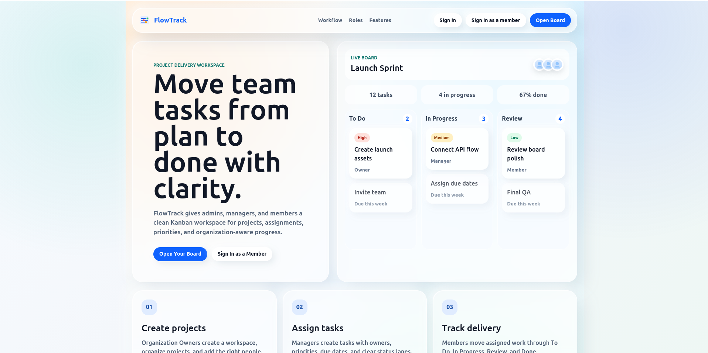
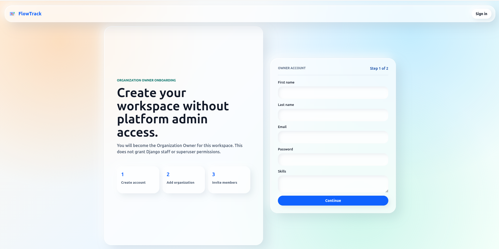
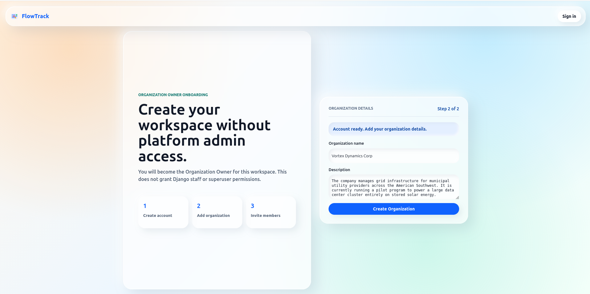
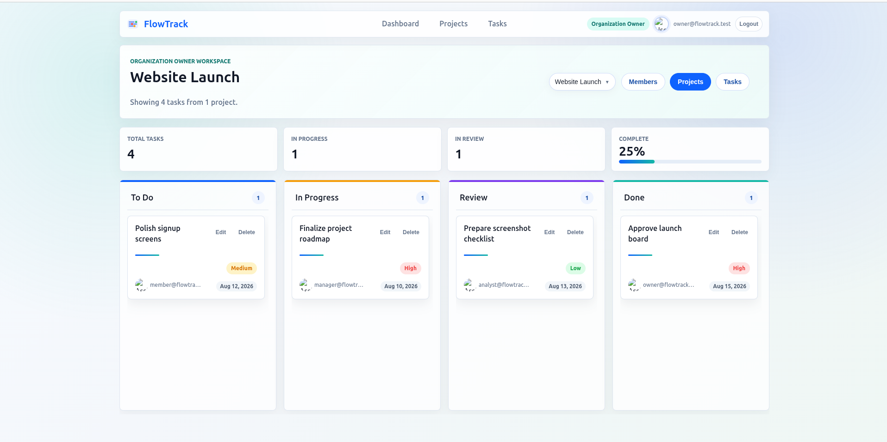
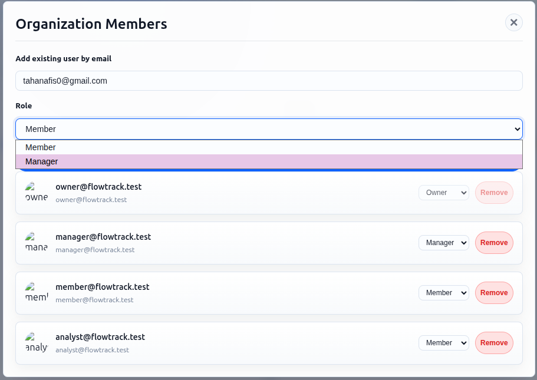
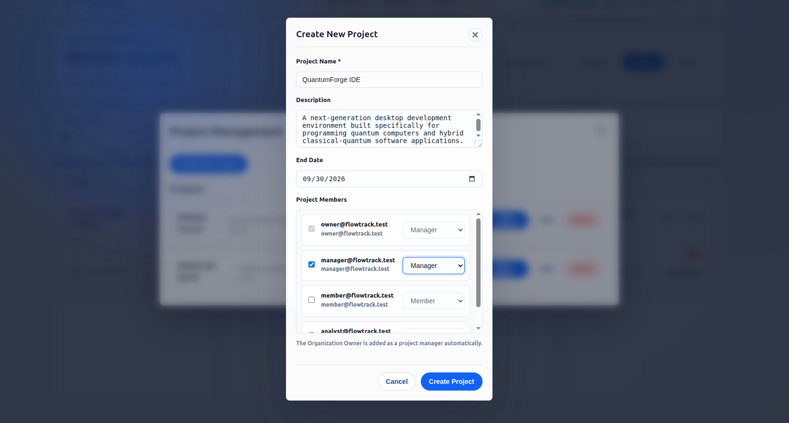
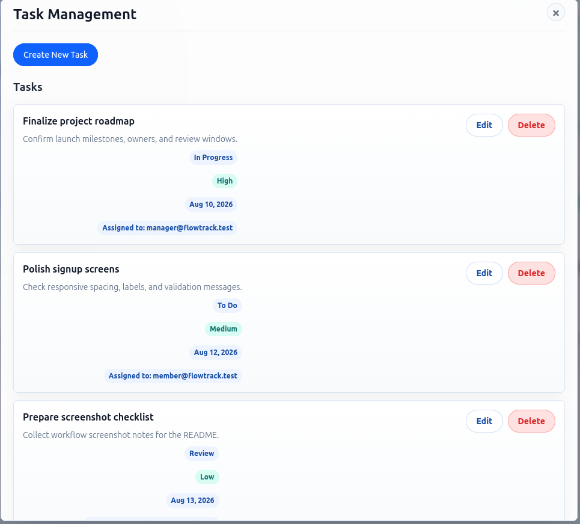
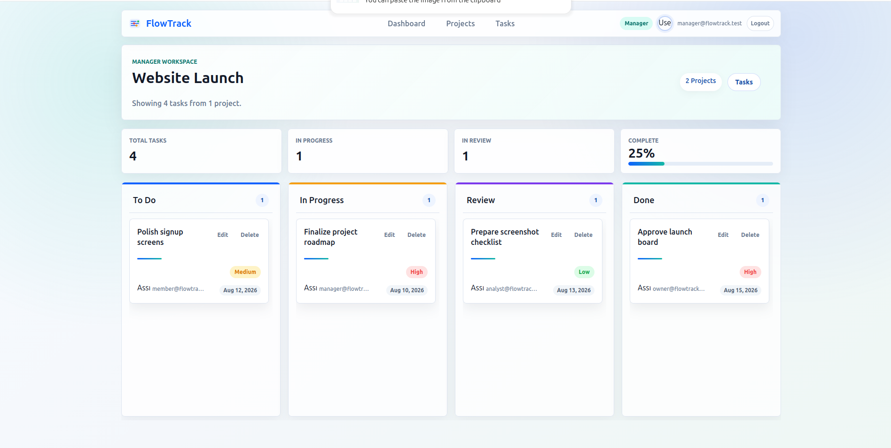
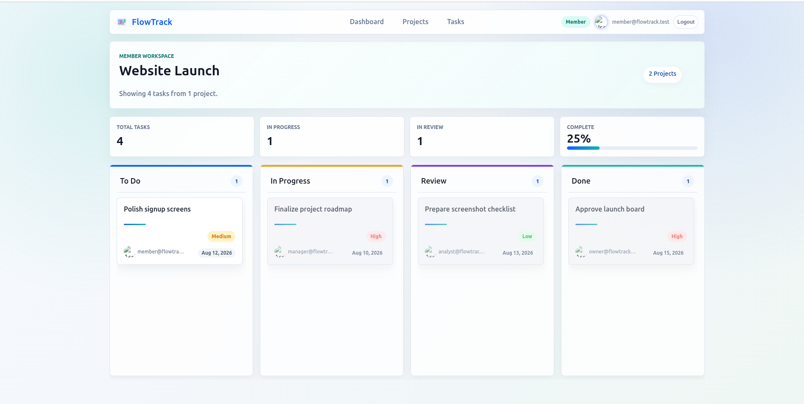

# FlowTrack

FlowTrack is a full-stack Kanban project management app built with Django REST Framework and React. It supports organization onboarding, role-based workspace access, project and task management, drag-and-drop task movement, profile pictures, and team member assignment.

## Views

The frontend has these routed views:

1. `/` - Public landing page.
2. `/create-organization` - Organization Owner onboarding flow.
3. `/login` - Login view for existing users.
4. `/signup` - Normal member account signup.
5. `/pending-invite` - Waiting state for users without organization membership.
6. `/board` - Main Kanban board.

The main board view changes by role:

- Organization Owner: can manage organization members, projects, project details, manager/member roles, and tasks.
- Manager: can manage tasks for accessible projects.
- Member: can view the board and move only tasks assigned to them.

Django `is_staff` and `is_superuser` accounts are platform administrators for Django Admin only. They are separate from Organization Owner accounts.

## Application Screenshots

The screenshots below show the current FlowTrack workflow from public entry to organization ownership, member assignment, project planning, and role-specific boards.

### Landing Page



The landing page introduces FlowTrack with a Kanban preview, role-focused navigation, and clear entry points for signing in, member access, or opening the board when already authenticated.

### Organization Owner Onboarding



The first onboarding step creates the personal account for the future Organization Owner. This keeps product ownership separate from Django platform administration.



The second onboarding step collects organization details. Submitting this form creates the organization and assigns the signed-in user the Organization Owner role.

### Owner Dashboard



The Organization Owner dashboard shows the owner role badge, project selector, organization-level actions, board metrics, and Kanban columns with assigned work.

### Organization Members



Owners can add existing users by email and choose whether they join as a Manager or Member. The owner role is protected from removal or accidental demotion.

### Project Creation



Project creation includes project details, deadline, member selection, and per-project Manager/Member assignment. The Organization Owner is automatically included as a project manager so tasks always have an available assignee.

### Task Management



Task management lists each task with status, priority, due date, and assignee. Owners and Managers can create, edit, and delete tasks according to backend permissions.

### Manager Dashboard



Managers can view the board, manage permitted tasks, and work across their accessible projects without seeing owner-only organization controls.

### Member Dashboard



Members see their accessible project board and assigned tasks. The UI reflects reduced permissions, and backend checks prevent owner-only or manager-only actions.

## Features

- Token-based signup and login.
- Custom user accounts with email login, username, profile picture, and skills.
- Organization creation flow where the creator becomes Organization Owner.
- Existing users can be added to an organization by email as Manager or Member.
- Role-aware board experience for owners, managers, and members.
- Project creation, editing, deletion, and detail review.
- Organization member management with owner, manager, and member roles.
- One-organization-per-user membership rule enforced by the backend.
- Task creation, editing, deletion, assignment, due dates, priorities, and statuses.
- Four Kanban statuses: To Do, In Progress, Review, Done.
- Drag-and-drop task movement with optimistic UI updates.
- Member-level protection so regular members can move only assigned tasks.
- Project selector for Organization Owners.
- Board metrics for total tasks, in-progress tasks, review tasks, and completion rate.
- Loading, empty, and error states.
- Responsive UI for desktop, tablet, and mobile screens.
- REST API helpers for projects, tasks, user role lookup, and Kanban data.

## Tech Stack

Backend:

- Django 5.2.3
- Django REST Framework
- SQLite for local development
- Django token authentication
- django-cors-headers
- Pillow for profile image support

Frontend:

- React 19
- Vite
- React Router
- @hello-pangea/dnd
- Custom CSS design system

## Project Structure

```text
FlowTrack/
├── Backend/
│   └── flowtrack/
│       ├── flowtrack/          # Django project settings
│       ├── kanbanboard/        # Models, serializers, views, URLs, permissions
│       ├── db.sqlite3          # Local development database
│       └── manage.py
├── api/
│   └── index.py                # Deployment entrypoint
├── frontend/
│   ├── src/
│   │   ├── assets/             # Logo and avatar assets
│   │   ├── components/         # Task, project, and modal components
│   │   ├── layouts/            # Header and board layout
│   │   ├── pages/              # Landing, onboarding, board, login, signup
│   │   └── utils/api.js        # Frontend API helper methods
│   └── package.json
└── README.md
```

## Getting Started

### Backend

```bash
cd Backend/flowtrack
python -m venv venv
source venv/bin/activate
pip install -r requirements.txt
python manage.py migrate
python manage.py runserver
```

The backend runs at `http://localhost:8000`.

### Frontend

```bash
cd frontend
npm install
printf "VITE_API_BASE_URL=http://localhost:8000\n" > .env
npm run dev
```

The frontend runs at `http://localhost:5173`.

## API Endpoints

Authentication:

- `POST /signup/`
- `POST /login/`

Organization:

- `GET /organization/`
- `POST /organization/`
- `GET /organization/members/`
- `POST /organization/members/`
- `PATCH /organization/members/{id}/`
- `DELETE /organization/members/{id}/`

Projects:

- `GET /projects/`
- `POST /projects/`
- `GET /projects/{id}/`
- `PUT /projects/{id}/`
- `DELETE /projects/{id}/`

Tasks:

- `GET /tasks/`
- `POST /tasks/`
- `GET /tasks/{id}/`
- `PUT /tasks/{id}/`
- `DELETE /tasks/{id}/`

Users and board data:

- `GET /kanban-board/`
- `GET /kanban-board/?project_id={id}`
- `GET /user-role/`
- `GET /users/` - organization-scoped users for owners/managers

## Data Model

- Account: custom Django user with email authentication, profile picture, and skills.
- Organization: workspace owned by an Organization Owner.
- OrganizationMembership: connects accounts to one organization with owner, manager, or member role.
- Project: organization-scoped work area with name, description, creation date, optional end date, and project members.
- ProjectMember: connects organization users to individual projects and stores their per-project member or manager role.
- Task: title, description, due date, priority, status, project, and assignee.

## Notes

- Local development uses SQLite.
- Profile images require media/static configuration in production.
- Users are currently constrained to one organization membership, while they can belong to multiple projects inside that organization.
